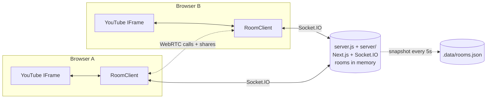

<div align="center">


# PlayCircle

### Watch YouTube together, perfectly in sync.

Create a room, paste a link, and everyone sees the same frame at the same time,<br/>
with live chat, emoji reactions, polls, video calls, screen sharing, a shared watch queue, and host controls. Everything runs in the browser, with no downloads and no accounts.

<br/>


[Features](#-features) · [Quick start](#-quick-start) · [Architecture](#-architecture) · [Socket events](#-socket-events) · [Deploy notes](#-deploy-notes)

</div>

---

## ✨ Features

<table>
<tr>
<td width="50%" valign="top">

### 🎬 Synced playback
Play, pause, and seek reach every viewer in real time. The server owns the playhead, so a late joiner **lands on the exact current frame** instead of the start. Every 3 seconds it broadcasts where the room really is, and any player that has drifted more than 1.5s quietly corrects itself.

</td>
<td width="50%" valign="top">

### 💬 Chat that knows the video
Type a timecode like `12:34` and it becomes a **link that jumps the video there** (for anyone with video control); the **📍 Moment** button drops in the current one. **Reply** to a message, **react** to it (👍 😂 ❤️ 🔥 😮 😢), and **search** the history. The host can **pin** a message and post **announcements**. Delete your own messages (the host can delete anyone's), **block** someone (hidden for you only, remembered in this browser), or **report** a message to the host. Presence shows a live **"N watching"** count and an avatar stack.

</td>
</tr>
<tr>
<td valign="top">

### 😂 Live reactions & moments
Tap an emoji under the player (😂 ❤️ 🔥 😮 👏 😭 💀 🎉) and it **floats up over the video** for everyone. On a YouTube video each reaction is stamped with the playhead, building a **Room reactions** strip: a bar chart of where the room reacted, with up to three peaks marked. **Click a bar to jump** there. The strip starts fresh with each video and is saved with the room.

</td>
<td valign="top">

### 🗳 Polls & votes
The host can run a **quick poll** (2–6 choices, a 15s–10min deadline, live results) or a **"What's next?"** poll over up to five queued videos. If the host makes it **binding**, the winner plays next. Anyone with chat can call a **vote to skip** or **replay** (two clicks to confirm). It's binding, lasts 30 seconds, and **passes early once a majority of the people present** agree. The creator can turn these votes off. One poll runs at a time, votes can be changed, and only people still in the room count.

</td>
</tr>
<tr>
<td valign="top">

### 🖥 Share anything
Anyone with video control can put a **browser tab (with audio)**, their **entire screen**, or a **video file from their device** on the stage, streamed live to the room over WebRTC. The presenter sets a **quality cap** (Auto / 1080p / 720p / 480p), and each viewer can pick a lower quality for themselves. Live stats (resolution, fps, bitrate), **automatic retry** when a viewer's connection stalls, and **"Tap to unmute"** when the browser blocks sound. See [Sharing a tab, screen, or file](#sharing-a-tab-screen-or-file) for the limits.

</td>
<td valign="top">

### 🔑 Password rooms
The creator can set or remove a password under **People → Room controls**. Newcomers see a password screen, while anyone already admitted walks straight back in. Passwords are **stored hashed** (scrypt with a per-room salt, never sent to anyone), and wrong guesses are **rate limited per connection, per address, and per room**, so reconnecting doesn't buy more tries. No accounts needed.

</td>
</tr>
<tr>
<td valign="top">

### 📞 Video & audio calls
Join voice-only or with your camera from the bar under the player. Includes mute and camera toggles, a speaking ring, and a tile for each person in the call. Calls run as a WebRTC mesh.

</td>
<td valign="top">

### 👑 Creator & host controls
Whoever creates a room keeps **first right**: whenever they're in it they hold the crown, and nobody else can remove, mute, or limit them. By default **only the host controls the video**, and anyone else who pauses or skips is snapped back to the room. For each person, the host can **allow video control, chat, or the call**, **make them host**, **mute** them, or **remove** them. The host can also **lock the room**, **set a password**, **open the video to everyone**, set how the queue works, switch skip/replay votes on or off, or **end the room**.

</td>
</tr>
<tr>
<td valign="top">

### 📋 Shared watch queue
The **Up next** tab lets anyone suggest a video. Viewers' suggestions wait for **host approval**, which the creator can turn off. Everyone **votes**, and the list is ordered **by votes or by hand**. With video control you can **play now** or **skip**; the host can also **remove**, **reorder**, and **clear**. When a video ends, the next one **plays automatically**. **Recently played** lets you queue a video again. Titles and thumbnails come from YouTube's oEmbed, so no API key is needed. The trade-off is that a video's length is only known once it has played.

</td>
<td valign="top">

### 🛟 Reliability
A **sync pill** shows where you stand: *In sync*, *Catching up*, *Buffering*, *Reconnecting*, or *Live*. After a dropped connection the room **rejoins and resyncs on its own**, and a background tab resyncs when you come back to it. Live streams are never seeked. Rooms are **saved to disk and come back (paused) after a restart**. Every payload is validated, chatty events are rate limited, room codes are checked, and the server caps out at 2,000 rooms and 50 people per room.

</td>
</tr>
<tr>
<td valign="top">

### 🌐 Public lobbies
Find open watch parties at `/lobby`. Each card shows the current video thumbnail, viewer count, and who's inside, and the list updates live.

</td>
<td valign="top">

### 🌙 Anonymous board
At `/vent`, anyone can post a thought anonymously. Each post gets a random alias and emoji, and new posts stream in live for everyone.

</td>
</tr>
</table>

**Also included:** an animated landing page (intro sequence, rotating hero, counting stats, scroll reveals, FAQ accordions), generated Open Graph and Twitter images, `sitemap.xml`, `robots.txt`, JSON-LD, a one-click invite link, **Resync**, and a "tap to join" overlay for browsers that block autoplay.

---

## 🚀 Quick start

```bash
git clone https://github.com/himanshudev28/playcircle.git
cd playcircle
npm install
npm run dev        # Next.js + Socket.IO on http://localhost:3000
```

> [!TIP]
> To see sync in action, open the same room code in two browser windows.

**Production build**

```bash
npm run build && npm start
```

**Tests**

```bash
npm test           # node --test integration tests in test/realtime.test.mjs
```

The tests mount the realtime server on a bare HTTP server and drive it with real `socket.io-client` connections. They run offline: `OFFLINE_META=1` skips the oEmbed title lookups.

### Routes

| Route | What it is |
|---|---|
| `/` | Landing page |
| `/join` | Pick a display name, then create a room (optionally public) or join by code |
| `/lobby` | Live list of public rooms |
| `/room/[code]` | The watch room: player (or a live share), reactions, polls, chat, Up next, people, and the call |
| `/vent` | Anonymous global board |

---

## 🧠 Architecture



**Server**

| File | Responsibility |
|---|---|
| [`server.js`](server.js) | Thin custom Node server that runs **Next.js and Socket.IO** on one port. It mounts the realtime layer with `attachRealtime(io, { dataFile })` and `SOCKET_OPTIONS`, and flushes rooms to disk on `SIGINT`/`SIGTERM` so a deploy or Ctrl-C doesn't lose them. |
| [`server/realtime.js`](server/realtime.js) | Room state (`Map<code, Room>`) and every core handler: admission (bans, lock, **passwords**, capacity), authority (creator and host), presence, playback sync plus the 3s heartbeat, call signaling, the lobby, the vent board, and persistence wiring. The playhead is stored as `time` plus an `updatedAt` timestamp, so late joiners receive `time + elapsed`. Room passwords are hashed with scrypt, and guesses go through **server-wide shared limiters** (per address and per room) on top of each socket's own limit; `TRUST_PROXY=1` keys the address on `X-Forwarded-For`. Feature modules plug in through a shared `ctx`. Exports `attachRealtime(io, options)` and `SOCKET_OPTIONS`. |
| [`server/queue.js`](server/queue.js) | The shared watch queue: suggestions, approval, votes, ordering, play/skip, auto-play next, and recently played. |
| [`server/social.js`](server/social.js) | Chat (replies, message reactions, pins, announcements, delete, report to host) and live reactions, which are stamped with the playhead to build the room's moments timeline. |
| [`server/polls.js`](server/polls.js) | One poll at a time: quick polls, "What's next?" (binding winner plays next), and skip/replay votes that settle early on a majority of the people present. Votes are per browser and only count while the voter is in the room. |
| [`server/stage.js`](server/stage.js) | Live sharing: who may present, a fresh `streamId` per share, and relaying signaling between the presenter and each viewer (media never touches the server). The share ends when the presenter stops, leaves, or loses video control. |
| [`server/limits.js`](server/limits.js) | Payload validation helpers, the `safe()` wrapper every handler goes through (a malformed payload can never throw inside the server), per-socket token-bucket rate limits, and the shared (server-wide) limiter used for passwords. |
| [`server/media.js`](server/media.js) | Parses YouTube links and IDs into `{ kind: "youtube", id }`, and fills in titles, channel names, and thumbnails from YouTube's oEmbed (cached, no API key). |
| [`server/persist.js`](server/persist.js) | Saves rooms as one JSON snapshot, written atomically and only when it changes. On startup, rooms are rebuilt field by field from that snapshot and come back paused. |

**Client**

| File | Responsibility |
|---|---|
| [`components/room/RoomClient.tsx`](components/room/RoomClient.tsx) | The room page. It wires up presence, chat, polls, reactions, settings, queue, and stage state, rejoins on every (re)connect, shows the password screen when a room asks for one, and lays out the Chat / Up next / People tabs. |
| [`components/room/useSyncedPlayer.ts`](components/room/useSyncedPlayer.ts) | Owns the YouTube player. It projects the server's playhead to "now" using the clock offset, corrects drift over 1.5s, and resyncs when the tab becomes visible. Local play/pause/seek is reported only when it actually differs from the room, so a correction can never echo back as an action. It also reports a video's length and its end. |
| [`components/room/useClockOffset.ts`](components/room/useClockOffset.ts) | Estimates the server's clock NTP-style with a few `time:ping` round-trips, keeping the fastest. It re-measures on every reconnect and every 30s. |
| [`components/room/SyncStatus.tsx`](components/room/SyncStatus.tsx) | The sync pill (In sync / Catching up / Buffering / Reconnecting / Live), debounced so brief blips don't flicker. |
| [`components/room/Chat.tsx`](components/room/Chat.tsx) | The chat tab: clickable timestamps, the 📍 Moment button, replies, reactions, the pinned bar, announcements, search, delete, report, and the local block list. |
| [`components/room/Reactions.tsx`](components/room/Reactions.tsx) | The reaction bar, the floating overlay on the player, and the Room reactions moments strip. |
| [`components/room/Polls.tsx`](components/room/Polls.tsx) | The running poll card, the host's poll composer, and the two-click Vote skip / Vote replay buttons. |
| [`components/room/useLiveStage.ts`](components/room/useLiveStage.ts) | The live share: a one-to-many WebRTC mesh where the presenter offers to each viewer (up to 8). It handles the capture or file stream, the quality cap and per-viewer quality, stats, and retries. |
| [`components/room/LiveStageView.tsx`](components/room/LiveStageView.tsx) · [`ShareMenu.tsx`](components/room/ShareMenu.tsx) | The share in the player box (viewer stream or presenter preview, with quality, stats, and Tap to unmute) and the Share button's tab / screen / file menu. |
| [`components/room/QueuePanel.tsx`](components/room/QueuePanel.tsx) | The "Up next" tab. It only emits; the server enforces every permission. |
| [`components/room/useCall.ts`](components/room/useCall.ts) | The WebRTC mesh. The newcomer to a call sends the offers. Each connection gets audio and video transceivers up front, so toggling the camera or mic is a `replaceTrack` with no renegotiation. |
| [`components/room/PeoplePanel.tsx`](components/room/PeoplePanel.tsx) · [`CallPanel.tsx`](components/room/CallPanel.tsx) | Host controls (including Room controls and the password) and the call UI. |
| [`lib/socket.ts`](lib/socket.ts) | Singleton `socket.io-client`, shared event types (YouTube and live media, chat, polls, reactions), and a per-browser `clientId` that host identity, removals, votes, and blocks are keyed on. |
| [`lib/timestamps.ts`](lib/timestamps.ts) | Formats video times and finds `m:ss` / `h:mm:ss` timecodes in chat text. |
| [`lib/youtube.ts`](lib/youtube.ts) | Parses a URL into a video ID and generates room codes. |
| [`lib/site.ts`](lib/site.ts) | Single source of truth for SEO metadata, the sitemap, robots.txt, and OG images. |

### Live streams vs. VODs

Regular videos get time-accurate catch-up: a late joiner seeks to the current position, and drift correction keeps everyone there. A **live stream** is never seeked, because seeking to an absolute time lands outside its DVR window. The client detects a live stream (YouTube's own flag, or a duration that is implausibly long or keeps growing) and stays at the live edge, where everyone is already in sync. The sync pill shows *Live*.

### Sharing a tab, screen, or file

A share replaces the YouTube video on the stage with `media: { kind: "live", … }`. The presenter holds one WebRTC connection per viewer and makes every offer; the server only relays signaling, scoped to that share's `streamId`. A viewer with no working connection after 10 seconds asks again (backing off), up to three times, then gets a **Retry** button. A share is never saved to disk.

| Limit | Why |
|---|---|
| Up to **8 viewers** per share | It's a mesh, so the presenter's upload is the bottleneck. Past 8 the presenter gets a warning; more needs an SFU. |
| Copy-protected sites (Netflix, Prime, Disney+…) **show black** | The browser blanks protected video in any capture. |
| **Tab audio** only in desktop Chrome and Edge | Other browsers share the picture without the tab's sound. |
| **Phones can't share** | Sharing is switched off on phones and tablets; they can still watch. |
| Local files are **re-encoded**, not original quality, and **don't work in Safari** | The file plays on the presenter's device and is captured live; Safari can't capture a video element. |
| Strict networks need **TURN** | Same as calls: set `NEXT_PUBLIC_ICE_SERVERS`. |

---

## 📡 Socket events

<details>
<summary><b>Full event reference</b> (click to expand)</summary>

<br/>

| Event | Direction | Purpose |
|---|---|---|
| `time:ping` | client → server | Acked with the server clock (`{ now }`) for clock-offset estimation |
| `room:join` | client → server | Join with a room code, display name, and `clientId` (plus title and public flag from the creator, and `password` for a password room). Sent again on every reconnect |
| `room:state` | server → client | Full snapshot: media, playhead (`time` as of server clock `at`), duration, host, settings, users, chat, queue, the `pinned` message, reaction `moments`, and the running `poll` |
| `room:users` | server → clients | Updated presence list |
| `room:denied` | server → client | `removed` / `locked` / `ended` / `full` / `invalid` / `password`. A `password` denial carries `wrong: true` after a bad guess, or `limited: true` when too many guesses were made (that try wasn't checked) |
| `room:host` | server → clients | Host changed |
| `room:settings` | server → clients | `{ locked, playback, approval, order, autoplay, voteSkip, hasPassword }` |
| `room:media` | server → clients | The current video with its title, channel, and thumbnail filled in |
| `room:notice` | server → client | Private heads-up, e.g. "The host turned off your chat" or a report sent to the host |
| `room:leave` | client → server | Left the room page |
| `player:action` | both | `load` / `play` / `pause` / `seek`. `load` carries `media: { kind: "youtube", id, title?, author?, thumb? }`, or `{ kind: "live", source, streamId, presenter, title, by }` for a share (`null` when a share ends), and is echoed to everyone, the sender included. `play` / `pause` / `seek` carry `time` and the video's `key` (`"yt:<id>"`); a stale key is dropped, and a live share has no timeline to drive. From someone without video control the action is refused and they're snapped back (`denied: true`) |
| `player:tick` | server → clients | Heartbeat every 3s: `{ key, time, isPlaying, at }`, used for drift correction |
| `player:meta` | client → server | A player learned the video's length; trusted from people with video control, from viewers once two of them agree |
| `player:ended` | client → server | A player reached the end; plays the next queued video when autoplay is on |
| `player:request-sync` | client → server | Ask for the authoritative position (Resync, or a tab becoming visible) |
| `chat:message` | both | Live chat. Send `{ text, replyTo?, announce? }`: `replyTo` is a message id (the server attaches a short quote), and `announce` only takes effect from the host or creator |
| `chat:react` | client → server | Toggle one emoji (👍 😂 ❤️ 🔥 😮 😢) on a message |
| `chat:pin` | client → server | Host or creator: pin a message by `id`, or unpin with `id: null` |
| `chat:delete` | client → server | Delete your own message; the host or creator can delete anyone's |
| `chat:report` | client → server | Report a message (with an optional reason) to whoever is running the room; acked `{ ok, error? }` |
| `chat:update` · `chat:removed` · `chat:pinned` | server → clients | A message changed (reactions, or a quote of a deleted message) / was deleted (its id) / the pinned message changed (or `null`) |
| `reaction:send` · `reaction` | both | Send a live emoji; everyone gets `{ emoji, name, color, byId, t }`, where `t` is the video time (or `null` during a share) |
| `poll:create` | client → server | `kind: "custom" \| "next" \| "skip" \| "replay"`. Custom and next: host only, with `question`, `options` or `itemIds`, `seconds`, and `binding` (next). Skip and replay: anyone with chat while votes are on. Acked `{ ok, error? }` |
| `poll:vote` · `poll:close` | client → server | Vote or change your vote / host ends the poll early (it resolves on the votes so far) |
| `poll:update` · `poll:closed` | server → clients | The running poll with live counts (or `null`) / the result: `{ poll, winner, passed, cancelled }` |
| `queue:add` | client → server | Suggest a video (`media` or a pasted link); the ack says whether it's `ready` or `pending`, or was a duplicate (counted as a vote) |
| `queue:approve` · `queue:remove` · `queue:move` · `queue:clear` | client → server | Approve, remove, reorder (manual order only), or clear: host and creator. Anyone can withdraw their own suggestion |
| `queue:vote` | client → server | Toggle your vote on a ready item |
| `queue:play` · `queue:skip` | client → server | Play an item now, or skip to the next one: anyone with video control |
| `queue:update` | server → clients | `{ items, history }`: the queue and recently played. The winner of a binding "What's next?" poll is flagged `next` |
| `host:kick` · `host:transfer` · `host:mute` · `host:perm` | client → server | Creator or host only; never against the creator |
| `host:reclaim` | client → server | Creator only: take the crown back from whoever holds it |
| `host:playback` · `host:settings` · `host:lock` · `host:end` | client → server | Creator, or the stand-in host while the creator is away. `host:settings` sets queue approval, order (`votes` / `manual`), autoplay, and `voteSkip` |
| `host:password` | client → server | Same people: set a password (4–64 characters) or remove it with `null`. Acked `{ ok, error? }`; people already admitted stay in |
| `stage:start` · `stage:stop` | client → server | Start sharing a `tab` / `screen` / `file` (people with video control; the ack carries the new `streamId`), or stop it (the presenter, or the host or creator) |
| `stage:want` · `stage:viewer` | both | A viewer is ready to watch; the server asks the presenter to connect to them |
| `stage:signal` | both | SDP and ICE relayed between the presenter and one viewer, scoped by `streamId` |
| `stage:quality` | both | A viewer's preferred quality (`auto` / `1080` / `720` / `480`), passed to the presenter |
| `stage:viewer-left` | server → client | Tells the presenter a viewer left, so it can close that connection |
| `call:join` | client → server | Enter the call; the reply (ack) carries your session and the peers to offer to, or `blocked` |
| `call:leave` · `call:state` | client → server | Leave the call; mic and camera state |
| `call:signal` | both | SDP offers/answers and ICE candidates relayed between peers |
| `call:left` · `call:force-mute` · `call:revoked` | server → client | Peer hung up / host muted you / host turned off your call access |
| `lobby:subscribe` · `lobby:unsubscribe` · `lobby:list` | both | Live public room list |
| `vent:post` · `vent:new` · `vent:list` | both | Anonymous board |

Every handler runs through `safe()` in [`server/limits.js`](server/limits.js): payloads are normalized and length-capped, and noisy events (joins, player actions, chat, reactions, polls, signaling, queue changes) are rate limited per socket. Password guesses and password changes are also limited server-wide, per address and per room, so a fresh connection doesn't reset them.

</details>

---

## 🛠 Deploy notes

### Hosting

PlayCircle is a long-running Node process (Next.js and Socket.IO in one server), so it needs a host that keeps it running: **Render, Railway, Fly.io, or a VPS**. Vercel can't run the realtime server; it can still serve the pages if `NEXT_PUBLIC_SOCKET_URL` points at a server running elsewhere.

The repo includes a Render Blueprint ([`render.yaml`](render.yaml)) for one free web service. It's live at **https://playcircle-174u.onrender.com**. Free instances sleep after about 15 idle minutes and take about 50 s to wake. Give it a **persistent disk** for the room save file; on a host with an ephemeral disk, rooms won't survive a redeploy.

If it runs behind a reverse proxy (as it does on most of these hosts), set `TRUST_PROXY=1`. Otherwise every visitor shares the proxy's address and one person's wrong password guesses use up everyone's per-address allowance. Leave it unset when nothing sits in front of the server, or clients could fake their address with an `X-Forwarded-For` header.

### Environment variables

| Variable | Purpose |
|---|---|
| `PORT` / `HOST` | Server bind address (default `localhost:3000`) |
| `NEXT_PUBLIC_SITE_URL` | Canonical URL for metadata, the sitemap, and OG images |
| `TURN_URLS` / `TURN_USERNAME` / `TURN_CREDENTIAL` | A TURN relay with a fixed login (e.g. ExpressTURN's free tier), served to browsers and the Android app by `/api/ice` |
| `ICE_SERVERS` | JSON array of extra STUN/TURN servers, server-side |
| `NEXT_PUBLIC_ICE_SERVERS` | Older build-time version of `ICE_SERVERS` (visible in the page source) |
| `NEXT_PUBLIC_SOCKET_URL` | Realtime server URL when the pages are hosted elsewhere (e.g. Vercel → Render) |
| `DATA_DIR` | Where the room save file lives (default `.data/`, saved as `rooms.json`) |
| `PERSIST` | Set to `0` to turn off saving rooms to disk |
| `TRUST_PROXY` | Set to `1` behind a reverse proxy, so password rate limits use the real client address from `X-Forwarded-For` |

### Calls and shares: STUN, TURN, and scale

Calls and shares use Google's public STUN servers, which work on most home networks. Peers on different networks, mobile data, or behind strict NATs need a TURN relay. Set it on the server, and `/api/ice` hands it to browsers and the Android app:

```bash
# .env.local (or the host's dashboard)
TURN_URLS=turn:free.expressturn.com:3478?transport=udp,turn:free.expressturn.com:3478?transport=tcp
TURN_USERNAME=…
TURN_CREDENTIAL=…
```

### Android app

Phone browsers can't share the screen. The Android app in [`android/`](android/README.md) shows the site in a WebView, so it has every feature, and adds native whole-screen sharing. See its README to install the APK.

> [!NOTE]
> Browsers allow camera and mic access only on **HTTPS or `localhost`**. To test from a phone on your LAN, use an HTTPS tunnel such as `cloudflared` or `ngrok`. A call mesh works for about 6 people and a share for up to 8 viewers; past that, move to an SFU such as LiveKit or mediasoup.

### Restarts and scaling out

Rooms live in memory in a single process and are saved to `.data/rooms.json` every few seconds and on shutdown. After a restart they're restored paused at the same position, with their queue, chat, pinned message, reaction moments, host, settings, and password hash, and wait 15 minutes for someone to come back. A running poll and a live share aren't saved. To run multiple instances, swap the file snapshot in [`server/persist.js`](server/persist.js) for Redis and add the Socket.IO Redis adapter.

### Optional: Google sign-in

The app uses guest display names, so it runs without configuration. To add **"Continue with Google"**, install `next-auth`, set `AUTH_GOOGLE_ID`, `AUTH_GOOGLE_SECRET`, and `AUTH_SECRET`, and pass the session name into the join flow. The sync layer already keys on a display name.

---

## 🗺 Roadmap

What's planned next, and what's on hold because it needs outside services, is tracked in **[ROADMAP.md](ROADMAP.md)**.

---

<div align="center">

Built by **[Himanshu Singh](https://github.com/himanshudev28)**

<sub>If this project helped you, consider giving it a ⭐</sub>

</div>
