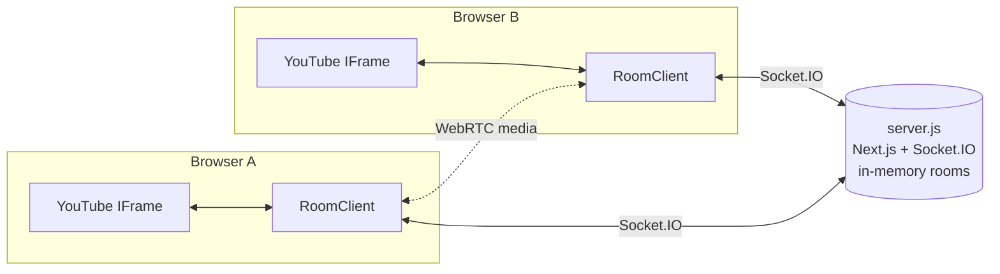

<div align="center">


# PlayCircle

### Watch YouTube together, perfectly in sync.

Create a room, paste a link, and everyone sees the same frame at the same time,<br/>
with live chat, video calls, and host controls. Everything runs in the browser, with no downloads and no accounts.

<br/>


[Features](#-features) · [Quick start](#-quick-start) · [Architecture](#-architecture) · [Socket events](#-socket-events) · [Deploy notes](#-deploy-notes)

</div>

---

## ✨ Features

<table>
<tr>
<td width="50%" valign="top">

### 🎬 Synced playback
Play, pause, and seek reach every viewer in real time. The server tracks elapsed playback, so a late joiner **lands on the exact current frame** instead of the start.

</td>
<td width="50%" valign="top">

### 💬 Live chat & presence
Chat with per-user colors and avatars, join/leave events, a live **"N watching"** count, and an avatar stack.

</td>
</tr>
<tr>
<td valign="top">

### 📞 Video & audio calls
Join voice-only or with your camera from the bar under the player. Includes mute and camera toggles, a speaking ring, and a tile for each person in the call. Calls run as a WebRTC mesh.

</td>
<td valign="top">

### 👑 Host controls
The room's creator gets a crown and can **transfer host**, **mute**, **remove**, **lock the room**, or **end it** for everyone. A host who refreshes keeps the crown.

</td>
</tr>
<tr>
<td valign="top">

### 🌐 Public lobbies
Find open watch parties at `/lobby`. Each card shows the current video thumbnail, viewer count, and who's inside, and the list updates live.

</td>
<td valign="top">

### 🌙 Anonymous board
At `/vent`, anyone can post a thought anonymously. Each post gets a random alias and emoji, and new posts stream in live for everyone.

</td>
</tr>
</table>

**Also included:** an animated landing page (intro sequence, rotating hero, counting stats, scroll reveals, FAQ accordions), generated Open Graph and Twitter images, `sitemap.xml`, `robots.txt`, JSON-LD, a one-click invite link, **Resync**, and a "tap to join" overlay for browsers that block autoplay.

---

## 🚀 Quick start

```bash
git clone https://github.com/himanshudev28/watchnparty.git
cd watchnparty
npm install
npm run dev        # Next.js + Socket.IO on http://localhost:3000
```

> [!TIP]
> To see sync in action, open the same room code in two browser windows.

**Production build**

```bash
npm run build && npm start
```

### Routes

| Route | What it is |
|---|---|
| `/` | Landing page |
| `/join` | Pick a display name, then create a room (optionally public) or join by code |
| `/lobby` | Live list of public rooms |
| `/room/[code]` | The watch room: player, chat, people, and the call |
| `/vent` | Anonymous global board |

---

## 🧠 Architecture



| File | Responsibility |
|---|---|
| [`server.js`](server.js) | Custom Node server that runs **Next.js and Socket.IO** together. Keeps room state in memory (`Map<code, Room>`): the current video, play state, the playhead plus an `updatedAt` timestamp, users, and recent chat. Late joiners receive `time + elapsed`. |
| [`components/room/RoomClient.tsx`](components/room/RoomClient.tsx) | Owns the socket and the YouTube player. An `applyingRemote` flag breaks the echo loop where applying a remote action would re-broadcast it. Seeks are detected by sampling `getCurrentTime`. |
| [`components/room/useCall.ts`](components/room/useCall.ts) | The WebRTC mesh. The newcomer to a call sends the offers. Each connection gets audio and video transceivers up front, so toggling the camera or mic is a `replaceTrack` with no renegotiation. |
| [`components/room/PeoplePanel.tsx`](components/room/PeoplePanel.tsx) · [`CallPanel.tsx`](components/room/CallPanel.tsx) | Host controls and the call UI. |
| [`lib/socket.ts`](lib/socket.ts) | Singleton `socket.io-client`, shared event types, and a per-browser `clientId` that host identity and removals are keyed on. |
| [`lib/youtube.ts`](lib/youtube.ts) | Parses a URL into a video ID and generates room codes. |
| [`lib/site.ts`](lib/site.ts) | Single source of truth for SEO metadata, the sitemap, robots.txt, and OG images. |

### Live streams vs. VODs

Regular videos get time-accurate catch-up: a late joiner seeks to the current position. A 24/7 **live stream** reports an implausible duration and can't be seeked into the past. The client detects this and joins at the live edge instead, where everyone is already in sync.

---

## 📡 Socket events

<details>
<summary><b>Full event reference</b> (click to expand)</summary>

<br/>

| Event | Direction | Purpose |
|---|---|---|
| `room:join` | client → server | Join with a display name and `clientId` |
| `room:state` | server → client | Full snapshot for a newcomer (video, time, users, chat) |
| `room:users` | server → clients | Updated presence list |
| `room:denied` | server → client | `removed` / `locked` / `ended` |
| `room:host` · `room:locked` | server → clients | Host changed / lock toggled |
| `room:leave` | client → server | Left the room page |
| `player:action` | both | `load` / `play` / `pause` / `seek` |
| `player:request-sync` | client → server | Ask for the authoritative position (Resync) |
| `chat:message` | both | Live chat |
| `host:kick` · `host:transfer` · `host:mute` · `host:lock` · `host:end` | client → server | Host-only; ignored from anyone else |
| `call:join` · `call:leave` · `call:state` | client → server | Enter or leave the call; mic and camera state |
| `call:peers` | server → client | Peers to send offers to after joining |
| `call:signal` | both | SDP offers/answers and ICE candidates relayed between peers |
| `call:left` · `call:force-mute` | server → client | Peer hung up / host muted you |
| `lobby:subscribe` · `lobby:list` | both | Live public room list |
| `vent:post` · `vent:new` · `vent:list` | both | Anonymous board |

</details>

---

## 🛠 Deploy notes

### Environment variables

| Variable | Purpose |
|---|---|
| `PORT` / `HOST` | Server bind address (default `localhost:3000`) |
| `NEXT_PUBLIC_SITE_URL` | Canonical URL for metadata, the sitemap, and OG images |
| `NEXT_PUBLIC_ICE_SERVERS` | JSON array of STUN/TURN servers for calls |

### Calls: STUN, TURN, and scale

Calls use Google's public STUN servers, which work on most home networks. Peers behind strict NATs or corporate firewalls need a TURN relay:

```bash
# .env.local
NEXT_PUBLIC_ICE_SERVERS='[{"urls":"stun:stun.l.google.com:19302"},{"urls":"turn:turn.example.com:3478","username":"u","credential":"p"}]'
```

> [!NOTE]
> Browsers allow camera and mic access only on **HTTPS or `localhost`**. To test from a phone on your LAN, use an HTTPS tunnel such as `cloudflared` or `ngrok`. A mesh works for about 6 people; past that, move to an SFU such as LiveKit or mediasoup.

### Scaling out

Room state lives in a single process. To run multiple instances, replace the in-memory `Map` with Redis and add the Socket.IO Redis adapter.

### Optional: Google sign-in

The app uses guest display names, so it runs without configuration. To add **"Continue with Google"**, install `next-auth`, set `AUTH_GOOGLE_ID`, `AUTH_GOOGLE_SECRET`, and `AUTH_SECRET`, and pass the session name into the join flow. The sync layer already keys on a display name.

---

## 🗺 Roadmap

- [ ] Twitch and Vimeo sources (the `player:action` layer is already source-agnostic)
- [ ] Redis-backed rooms for horizontal scaling
- [ ] SFU for calls with more than 6 people
- [ ] Optional accounts and saved rooms

---

<div align="center">

Built by **[Himanshu Singh](https://github.com/himanshudev28)**

<sub>If this project helped you, consider giving it a ⭐</sub>

</div>
